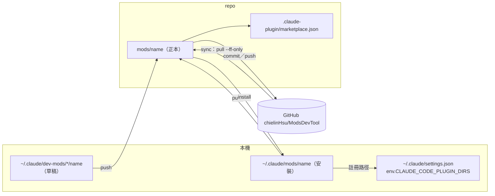
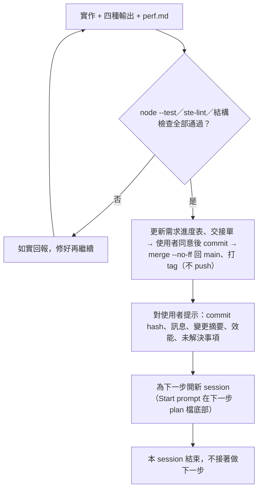

# ModsDevTool — 總體計畫（Master Plan）

> 進度：[current-status.md](current-status.md)（需求進度表）｜ 架構：[architecture.md](architecture.md) ｜ 決策：[decisions.md](decisions.md) ｜ 工作規則：[../AGENTS.md](../AGENTS.md)
> 建立日期：2026-10-22（由 README、AI_CONTEXT、architecture 與 changelog 回填）。本檔回答「整個專案要做什麼、不做什麼、分幾步做」；每一步的細節在 `docs/plan/<ID>-<slug>.md`，目前做到哪在 `docs/current-status.md`。

## 修改紀錄

| 日期 | 修改者 | 說明 |
|---|---|---|
| 2026-10-22 | Claude Code (Sonnet 5.5) | 導入 AI 結構 2.0.0（[ADR-002](adr/002-ai-structure-2-0-0.md)）時建立，依 README、AI_CONTEXT、architecture 與 changelog 回填 |

## 1. 要做什麼

收集 Caspar 自製的 Claude Code mod（以 function hooks 撰寫的 plugin），並讓同一組 mod 能在多台機器上使用。每個 mod 放在 `mods/<name>/`，可持續新增；`scripts/mods.mjs` 把本機有、repo 沒有的 mod 加進 repo（`push`），也把 repo 有、本機沒有的 mod 安裝到 `~/.claude/mods/` 並註冊載入（`install`），`sync` 一次做完。成功的樣子：新機器 `git clone` 後執行 `node scripts/mods.mjs sync`、重開 Claude Code，所有 mod 都載入，且兩邊內容不同時不會被悄悄覆蓋。

**這一版不做**：

- 不做 mod 的刪除與雙向自動合併（腳本只新增缺少的 mod，內容不同要 `--update` 且人工決定）。
- 不做 npm 套件、打包發布或自動更新；marketplace 清單只是附帶，主要安裝方式是 `~/.claude/mods` + `CLAUDE_CODE_PLUGIN_DIRS`（[ADR-001](adr/001-mods-sync-and-install.md)）。
- 不修改 `~/.claude/settings.json` 以外的全域設定（只動 `env.CLAUDE_CODE_PLUGIN_DIRS`），不由 agent 代替使用者執行 `push`／`install`／`sync`。
- 不內建 mod 的建置流程；mod 由 Claude Code 直接載入原始碼。

## 2. 架構總覽

三個位置（草稿、本機安裝、repo 正本）加一支同步腳本；核心邏輯是純檔案操作，git 與 `claude` CLI 只在指令列入口呼叫。細節見 [architecture.md](architecture.md)。

### 為什麼這樣切（目的／原因／效果）

- **`lib.mjs` 純檔案邏輯、`mods.mjs` 呼叫外部程式**：目的是讓核心可以在暫存資料夾測試；原因是 git 與 `claude` CLI 會改動真實環境；效果是 `tests/mods.test.mjs` 不碰真實設定。
- **預設只新增、不覆蓋、不刪除**：目的是避免兩台機器各自修改時互相蓋掉；原因是無法可靠判斷哪一份才是要的；效果是衝突時列出差異，由人決定是否 `--update`。
- **沿用 `~/.claude/mods` 與 `CLAUDE_CODE_PLUGIN_DIRS`**：目的是換機台後行為一致；原因是本機既有 mod 已這樣載入；效果是不需要改 Claude Code 的載入方式。
- **`push`／`sync` 只在 `main` 執行、commit 訊息由 `buildCommitMessage` 產生**：目的是讓腳本提交的歷史與手動提交同一格式；原因是 `main` 以外的分支不該被腳本直接推送；效果是每個腳本 commit 都符合 `project-rules.md` 的骨架。

## 3. SOLID 對應

本專案沒有類別階層，以模組與函式落實。

| 原則 | 在本專案的落實方式 |
|---|---|
| S | `lib.mjs`（檔案邏輯）、`mods.mjs`（指令列與外部程式）、`tests/`（驗證）各有單一變更理由；每個 mod 是獨立資料夾 |
| O | 新增 mod 是「新增資料夾 + push」，不改同步腳本；新增子指令是新增獨立函式並登記 `HELP` |
| L | 同一組函式契約（路徑參數、回傳結構）由 `tests/mods.test.mjs` 驗證，mod 的 hook 契約由 `claude plugin validate`／`test` 驗證 |
| I | `lib.mjs` 只露出各指令需要的最小函式；mod 只 import 自己的檔案與 `claude-code` |
| D | 設定目錄、來源資料夾以參數與環境變數（`MODS_CLAUDE_DIR`、`--from`）傳入，不在函式內寫死 `~/.claude` |

## 4. 效能策略與測試

無效能需求：腳本一次只處理少量小檔案。測試分類與驗證指令見 `AI_CONTEXT.md`「建置與測試」：`node --test tests/mods.test.mjs`（同步核心，暫存資料夾）、`claude plugin validate`／`test`（單一 mod）、在 Claude Code 實際看畫面（mod 的 UI）。

## 5. 實作步驟

每一步在 `docs/plan/` 有一份計畫檔（範本 [plan/_template.md](plan/_template.md)），做法依 `project-rules.md` 的 Step Protocol。步驟的狀態寫在 `docs/current-status.md` 的需求進度表，本表只放順序與依賴。目前已完成的 S01–S03 對應進度表 R01–R03，沒有補計畫檔。

| 步驟 | 層級 | 主題 | 關鍵產出 | 主要量測 |
|---|---|---|---|---|
| S01 | 底層 | 同步核心與指令列（R01） | `scripts/mods/lib.mjs`、`scripts/mods.mjs`、`tests/mods.test.mjs` | `node --test` 16/16 |
| S02 | 應用 | 收錄第一批 mod（R02） | `mods/blast-radius`、`mods/replay-theater`、`marketplace.json` | `claude plugin validate` |
| S03 | 底層 | Windows 呼叫 `claude` CLI 的相容性（R03） | `cmd.exe` 呼叫、找不到 CLI 時略過 | `node --test` |
| S04 | 應用 | 收錄其餘本機 mod（R08） | `agents-panel`、`disk-status`、`taskboard-pane`、`usage-bar` | 每個 mod 的 validate 與實際畫面 |
| S05 | 驗證 | 其他機台與 macOS／Linux 實測（R09） | 實測紀錄 | 新機器 `sync` 後 mod 載入 |
| S06 | 底層 | 刪除 mod 的流程（R10） | 子指令設計與 ADR | 暫存資料夾測試 |

為什麼這個順序：先有可靠的同步核心（S01），再放進實際的 mod（S02），修好 Windows 差異（S03）；之後依使用者需求收錄更多 mod，並在不同機台驗證；刪除流程風險最高（會動到兩端資料），放最後並先寫 ADR。

## 6. 每一步的輸出規範（4 種輸出形式）

適用範圍：Step Protocol 的步驟與進度表中類型為「功能」的需求；小修正免。範本在 [steps/_template/](steps/_template/)。

| 輸出 | 用法 | 檔案 |
|---|---|---|
| 寫作 Writing | ASD-STE100 風格英文寫 Purpose／Reason／Effect，附繁中摘要；`tools/ste-lint.mjs` 檢查句長與被動語態 | `spec.md` |
| 圖解 Diagrams | Mermaid 結構圖、流程圖、序列圖、狀態圖 | `diagram.md` |
| 互動網頁 Web pages | 單檔 HTML，把概念變成能操作的小 App | `explainer.html` |
| 解說影片 Explainer videos | 一定交付分鏡腳本；實際影片是選配，要使用者同意 | `storyboard.md` |

**誠實說明**：STE-lint 只檢查句長與簡單的被動語態，不是完整的 ASD-STE100 驗證；影片是分鏡而非成片。

## 7. 每完成一步：commit、提示、開新 session

使用者同意後在工作分支 commit，以 `merge --no-ff` 合併回 `main` 並打 tag；**不包含 push**，推送與開 PR 要使用者另外同意（見 `project-rules.md` Step Protocol 第 5 步與「Git」）。

為什麼每步開新 session：每個步驟的上下文很大且彼此獨立；新 session 只靠 `AGENTS.md`、`docs/current-status.md` 與該步 plan 檔就能接手，不被前一步的雜訊拖累。

## 8. 風險與待決策

| # | 風險／問題 | 對策 | 何時處理 |
|---|---|---|---|
| 1 | 同一 mod 兩台機器都改過，`--update` 會以一方取代另一方 | 預設不覆蓋、列出差異；install 取代前備份到 `~/.claude/mods-backup/` | 發生時由使用者決定 |
| 2 | 其他機台與 macOS／Linux 沒有實機驗證 | S05 實測並記錄 | 使用者換機台時 |
| 3 | `install` 會註冊刻意不載入的同名 mod（R11） | 先在文件註明，之後評估排除清單 | 使用者決定 |
| 4 | AI 結構的 hook、agents、skill 只做過靜態檢查，沒有在本專案 session 實際載入驗證 | 下次在本專案開 session 時確認 hook 有輸出路由建議 | 導入 2.0.0 的 PR 合併後 |
