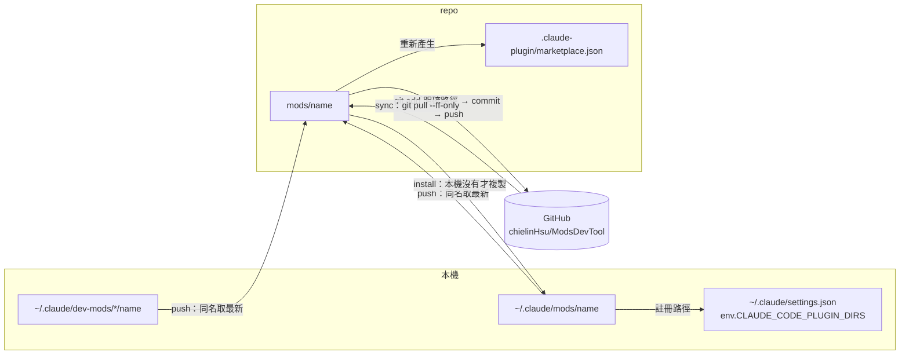

# 架構

## 一、組成

| 元件 | 責任 |
|---|---|
| `mods/<name>/` | 一個 Claude Code mod 的原始碼（function hooks plugin），repo 中的正本 |
| `.claude-plugin/marketplace.json` | 依 `mods/*` 產生的清單；讓 repo 也能當 Claude Code marketplace 使用 |
| `scripts/mods/lib.mjs` | 純檔案邏輯：找出 mod、計算內容雜湊、複製、產生 marketplace、註冊 `CLAUDE_CODE_PLUGIN_DIRS` |
| `scripts/mods.mjs` | 指令列：解析參數、呼叫 git（pull／add／commit／push）與 `claude plugin validate`、輸出結果 |
| `tests/mods.test.mjs` | 以暫存資料夾驗證 `lib.mjs` |

## 二、三個位置

| 位置 | 角色 | 由誰寫入 |
|---|---|---|
| `~/.claude/dev-mods/<session>/<name>/` | 開發中的草稿（session 熱重載） | Claude Code 開發 mod 時 |
| `~/.claude/mods/<name>/` | 本機安裝位置，列在 `~/.claude/settings.json` 的 `env.CLAUDE_CODE_PLUGIN_DIRS` 後於啟動時載入 | `install`／`sync`，或使用者手動 |
| repo `mods/<name>/` | 跨機台共用的正本 | `push`／`sync` |

## 三、資料流

`sync` = `pull` → `install`（repo 有、本機沒有）→ `push`（本機有、repo 沒有）。兩個方向預設都只「新增缺少的」；內容不同時列出差異並略過，`--update` 才以較新的一方取代。

## 四、判定規則

- **是不是 mod**：資料夾有 `.claude-plugin/plugin.json`，且 `name` 符合命名規則。repo 端另外要求資料夾名稱等於 `name`。
- **同不同**：`listModFiles` 列出要同步的檔案（排除引擎產生的 `.claude-plugin/types/`、引擎 `tsconfig.json`、`*.log`／`*.tmp`／`*.bak`、`node_modules`、符號連結），依路徑與 LF 正規化內容計算 SHA-256。
- **同名多份（push）**：已安裝與各 session 草稿中，取檔案修改時間最新的一份。
- **安全界線**：
  - push 前 `mods/` 與 `marketplace.json` 必須沒有未提交修改；有任何 mod 驗證失敗就不 commit。
  - install 取代前把舊版複製到 `~/.claude/mods-backup/<name>-<時間>`；改 `settings.json` 前寫 `settings.json.mods-backup`。
  - 不刪除任何一端的 mod。

## 五、平台差異

- `CLAUDE_CODE_PLUGIN_DIRS`：Windows 以 `;` 分隔並寫成正斜線路徑；macOS／Linux 以 `:` 分隔。
- Windows 的網路 git 指令加 `-c http.sslBackend=schannel`（`MODS_GIT_SSL_BACKEND` 可改）。本 repo clone 時也寫入了 repo 層級的 `http.sslBackend=schannel`。
- `claude` CLI 找不到時略過 `plugin validate`，只顯示提示，不中止。
